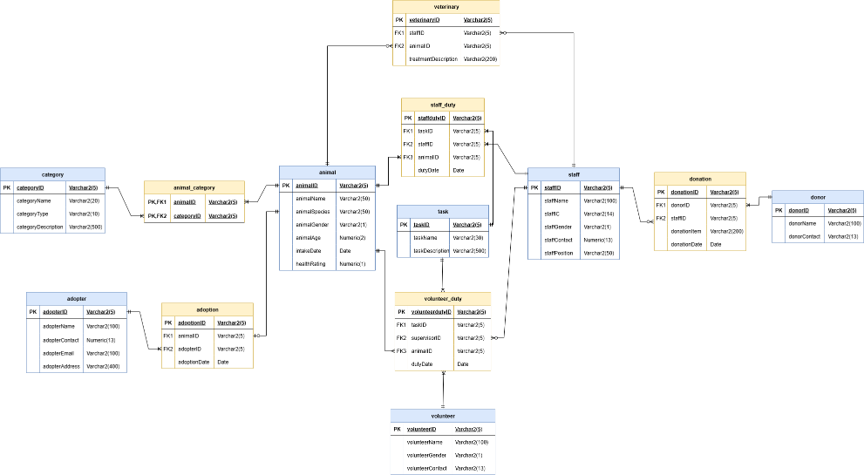

# Pawradise Animal Shelter Database System (Oracle SQL)

A complete relational database management system (RDBMS) built with **Oracle SQL** to digitize operations for Pawradise Animal Shelter (a Malaysian NGO). Aligned with **UN SDG 15 (Life on Land)**, the system manages animal welfare, adoptions, medical history, staff duties, volunteer scheduling, and donor tracking.

## Entity Relationship Diagram (ERD)

Below is the conceptual relational model and entity mapping for the database architecture:

## Features & Highlights
* **Complete Schema Cleanup & Initialization:** Includes `DROP TABLE ... CASCADE CONSTRAINTS` execution to ensure smooth re-runability.
* **Data Integrity & Validations:**
  * Structural `CHECK` constraints (e.g., gender `M`/`F`, animal age `0–40`, health rating `1–5`).
  * Regex validation for Malaysian IC numbers (`^\d{6}-\d{2}-\d{4}$`) and email addresses.
  * Primary and Foreign Key relational constraints across all entities.
* **Realistic Mock Dataset:** Populated with sample operational data across 13 relational tables.
* **Analytical SQL Queries:** Includes advanced queries demonstrating outer joins, multi-table joins, subqueries, aggregation, and pattern matching.

## Database Architecture

The schema consists of 13 interconnected tables:

1. **`category`** – Defines animal categories (e.g., Kitten, Adult Dog, Senior Cat).
2. **`animal`** – Tracks intake dates, health ratings, age, species, and gender.
3. **`animal_category`** – Junction table handling many-to-many relationships between animals and categories.
4. **`staff`** – Records staff details, position, contact, and IC validation.
5. **`task`** – Defines operational tasks (e.g., Feeding, Grooming, Health Monitoring).
6. **`staff_duty`** – Logs staff duty assignments mapped to specific animals.
7. **`adopter`** – Stores adopter personal information and validated email contacts.
8. **`adoption`** – Links adopters to animals with adoption timestamps.
9. **`veterinary`** – Logs medical treatments, vaccinations, and surgeries handled by staff.
10. **`donor`** – Stores donor contact information.
11. **`donation`** – Records financial and item contributions processed by staff.
12. **`volunteer`** – Stores volunteer contact and demographic data.
13. **`volunteer_duty`** – Tracks assigned volunteer tasks, supervising staff, and targeted animals.

## Key Queries Included

The repository includes queries designed for operational reporting:

* **Query (a) Outer Join:** Retrieves all animals with their adoption status and adopter names (if adopted).
* **Query (b) Multi-Table Join & Grouping:** Counts volunteer duties supervised per staff member along with task names.
* **Query (c) Pattern & Date Matching:** Identifies specific volunteers and their assigned duties during July 2024 using `LIKE` and `TO_CHAR`.
* **Query (d) Complex Logical Filtering:** Uses `AND`/`OR` subqueries to list staff handling health/quarantine monitoring across target date ranges.
* **Query (e) Double Subquery:** Filters unadopted animals that belong specifically to the "Adult Cat" category (`C2`).
* **Query (f) Scenario Analysis:** Identifies long-term shelter residents with top-tier health check ratings (`healthRating = 5`).

## How to Run

1. Clone or download this repository.
2. Open **Oracle APEX** (SQL Commands) or **Oracle SQL Developer**.
3. Execute `animal_shelter_db.sql` to build the schema, insert sample records, and run analytical reports.
